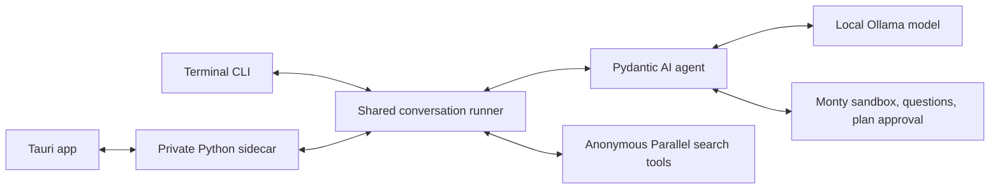

# Vikram

A private desktop chat app and CLI, built with Tauri, Pydantic AI, and Ollama.

Vikram runs a single agent defined in this repository. Its instructions live in
`vikram/agent.py`, and it sends model requests to your local Ollama server at
`http://localhost:11434/v1`. Models that support tool calling can also run
Python in an isolated sandbox, ask you clarifying questions, and, in plan mode,
wait for your approval before they work.

## Desktop app (Apple Silicon Mac)

Install the desktop app and CLI together by opening **Install Vikram.app** from
the installer ZIP. Then open `~/Applications/Vikram.app` or run `vikram` in a new
terminal. Use `vikram update` to update both, `vikram update --check` to check
without installing, and `vikram --version` to see the running CLI version.
Updates use stable GitHub Releases; no release is published yet. The local
installer is ad-hoc signed, pending Developer ID signing and notarization for
public distribution. [Installation and release details](docs/releases.md).

The Tauri app supports saved chats and flat folders, per-chat local models and
advertised thinking settings, streamed replies, stop/retry, Markdown/code copy,
and image, PDF, Word, text/code, CSV, and Excel attachments. Its light and dark themes follow
[raniendu.dev](https://raniendu.dev). Fonts ship with the app.

Use your existing Ollama installation and installed models. The picker rejects
remote/cloud-backed and non-chat models. No model downloads happen automatically.
One reply runs at a time; other chats keep independent drafts and histories.

Build with native ARM64 Python 3.13+, Node 22.12+ and Rust (Xcode command-line
tools must be installed):

```bash
uv sync --locked
npm --prefix apps/desktop ci
uv run python scripts/build_desktop.py
```

To produce the combined installer as well:

```bash
uv run python scripts/build_installer.py
```

Open `dist/installers/Install Vikram.app` to install both components in one
action. Packaging also produces `dist/installers/Vikram-0.1.0-macos-arm64.zip`.
The installer preserves an existing uv-managed CLI launcher, keeps chats and
models, and checks the 20 GiB reserve before changing the installed version.

Open `apps/desktop/src-tauri/target/release/bundle/macos/Vikram.app`.
The bundled app includes its Python service; it needs no separate Python runtime.
This is an ad-hoc signed local build, not a notarized distribution release.
Local signing leaves Hardened Runtime off so the bundled Python libraries can
load. Distribution would require Developer ID signing and notarization. The
build runs the bundled Python sandbox once, then verifies the bundle signature
and sidecar startup in an empty test library.
The build script requires 24 GiB free to protect the owner's 20 GiB reserve.

For development:

```bash
uv run python scripts/build_desktop.py --sidecar-only
npm --prefix apps/desktop run desktop
```

The browser-only Vite preview shows the layout. Chat operations require the Tauri
shell; there is no chat HTTP server. The renderer talks to a constrained Rust
bridge and a versioned private stdio service.

Chats, drafts, settings and imported file copies live in
`~/Library/Application Support/dev.raniendu.vikram/`, separately from evaluation
history. SQLite and attachments are private to the current account. There is no
additional app password/encryption layer or cloud sync. Deleting a folder keeps
its chats. Deleting a chat removes only its app-owned attachments, never source files.
Use the trash button beside a conversation in the sidebar, then confirm its name
in the deletion dialog. The header's three-dot menu also includes Delete chat.
Stop a running reply before deleting its conversation.
The developer-only `VIKRAM_CHAT_DATA_DIR` environment variable selects an isolated
test library; it is not available to the renderer.

Attach up to four files per message, 10 MiB each. Images retain the 24-megapixel limit. Images in
saved history are omitted with a marker when a text-only model is selected.
Unsupported draft images must be removed or used with an image-capable model.
When Ollama returns thinking text, a collapsed **Thinking** row lets you inspect
it live or after the reply. Thinking has its own copy action and is saved with
the desktop reply, up to 64,000 characters; longer traces show a limit notice.
It is never added to later conversation context, logs, or evaluation records.
Old replies cannot recover thinking that was previously discarded.
Failed/stopped/interrupted
partials remain copyable and are excluded from subsequent inference context.
Only the latest unsuccessful user turn can be retried.

Keyboard: **⌘N** new chat, **⌘B** sidebar, **⌘,** settings, **Enter** send,
**Shift+Enter** newline. Closing during a reply asks before stopping it.

See the [approved spec](docs/superpowers/specs/2026-10-14-local-chat-design.md)
and [implementation/validation record](docs/superpowers/plans/2026-10-14-local-chat.md).

## Documents and automatic web search

Documents are read locally. PDF text layers, Word main-body text/tables, UTF-8
or BOM-marked UTF-16 text/code, CSV/TSV, and XLSX cell values are supported.
Open a document card to inspect the extracted text. Large documents show a
Partial notice: up to 20,000 characters per file, 100 PDF pages, 10 sheets,
1,000 rows and 100 columns are processed. Formula caches are used when present;
formulas and macros never run. Scanned PDFs need OCR, which is not included.
Imports run in a disposable parser process with a 15-second timeout. File
imports and builds preserve at least 20 GiB free space.

CLI and Tauri use the same conversation runner, agent instructions, model
capability checks, web tools, limits, and completed-turn context policy.
Compatible local models always have `web_search` and `web_fetch` available and
decide when to use them. This applies to interactive and one-shot CLI calls and
every desktop chat, including chats previously saved with Web Off. Neither
interface has a web on/off setting. The old CLI `--web` flag is rejected;
old `/web` commands explain the automatic policy without sending a message.

Every model request includes the Mac's current local date, time, weekday,
timezone/UTC offset and UTC timestamp in its system instructions. This refreshes
throughout a session and is independent of web tools; asking for the time needs
no search.

Search uses [Parallel's anonymous MCP endpoint](https://docs.parallel.ai/integrations/mcp/search-mcp)
without API keys, OAuth, or a paid fallback. Its free service has rate limits.
The local model receives retrieved excerpts; answers remain local. Queries,
search objectives, requested URLs, and an opaque session ID go to Parallel.
Queries may include conversation or attachment details. Original files and full
chat history are not uploaded as a search payload. CLI and app show tool
activity, failures, and retrieved sources.

Each reply permits three serial remote calls and ten model requests, with
bounded excerpts and request timeouts. Stop/Ctrl-C closes model and search
requests. Models without tool support continue normal chat with a notice.
There are no arbitrary MCP servers or computer-control tools.

The [extension spec](docs/superpowers/specs/2026-10-14-documents-and-web-search-design.md)
and [build record](docs/superpowers/plans/2026-10-14-documents-and-web-search.md)
cover this behavior.

## Questions, plan mode, and the Python sandbox

Tool-capable models get three local tools in both the CLI and the desktop app,
built on [Pydantic AI Harness](https://pydantic.dev/docs/ai/harness/):

- **Python sandbox** (`run_code`, Harness Code Mode with no tools inside it).
  Vikram writes and runs Python for exact arithmetic, counting, dates, and data
  processing. Code runs locally in [Monty](https://github.com/pydantic/monty),
  Pydantic's sandboxed interpreter. It has no files, network, environment
  variables, clock, subprocesses, or third-party packages, and supports only
  part of the standard library. Each snippet has 15 seconds and 128 MiB. Errors
  go back to the model to fix, and a failing snippet never ends the reply.
- **Clarifying questions** (`ask_user_question`, Harness Ask User). When a
  request is ambiguous, Vikram shows multiple-choice questions and waits. Pick
  options, type your own answer, or skip; skipped questions make Vikram choose
  and say what it chose.
- **Plan mode.** Vikram first asks any questions and does research, then submits
  a numbered plan. It cannot run code until you approve. Approve to let it carry
  out the plan in the same reply (plan mode then turns off), request changes with
  feedback, or choose Not now to keep the plan for later.

In the desktop app, use the **Plan** toggle beside the paperclip. Questions and
plans appear as cards in the reply, and **Ran Python** rows expand to show the
code and its output. In the terminal, `/plan` toggles plan mode (`--plan` starts
in it). Questions and plans pause the live reply: type option numbers or your
own words (Enter skips), and answer plans with `y`, `c` (request changes), or `n`.
Ctrl+C stops the reply. `/activity` shows sandbox code, output, answers, and
plans. Piped one-shot runs cannot ask, so questions are declined and plans stay
unapproved.

Per reply: at most six sandbox runs, three question calls, three plan
submissions, and ten model requests; the last request offers no tools so the
model must answer. A question or plan waits up to 15 minutes. Later turns see
your answers, the latest plan and decision, and recent sandbox runs.
See the [design](docs/superpowers/specs/2026-10-20-questions-plan-mode-sandbox-design.md).

## Run the CLI

The combined Mac installer bundles the CLI's Python runtime. For a developer
checkout, install [uv](https://docs.astral.sh/uv/). Both installations need
[Ollama](https://ollama.com/). Start
the Ollama app, or start its server in a terminal:

```bash
ollama serve
```

If Ollama is already running, skip `ollama serve`. In another terminal:

```bash
uv sync --locked
ollama pull gemma4:26b-a4b-it-qat
uv run vikram
```

Or ask one question:

```bash
uv run vikram "Explain Python generators in three sentences."
uv run vikram --thinking off "Find the official Ollama tool-calling documentation."
uv run vikram --plan "Compare 10-year savings for 3%, 4%, and 4.5% yearly rates."
```

CLI conversation history exists only in memory for the current interactive session.
The desktop app saves its own chats independently. In a terminal, Vikram streams
formatted Markdown with a compact activity line and editable multiline input.
Normal terminal scrollback is retained. **Enter** sends, **Alt+Enter** adds a
newline, and **↑** recalls input. **Ctrl+T** reveals/hides live thinking;
afterward, **Ctrl+T** or `/trace` prints the latest reply's thinking on request.
`/activity` inspects its web requests, sandbox runs, questions, and plans.
`/plan` toggles plan mode. **Ctrl+C** stops a running reply and
returns to input; at the input prompt it exits. `/exit` or **Ctrl+D** also exits.
Terminal thinking stays in memory only. One-shot commands and redirected output
keep plain answer text without thinking or terminal decoration.

## Choose a local model

The default is `gemma4:26b-a4b-it-qat`. To use another model you have pulled into
Ollama, pass its name:

```bash
uv run vikram --model MODEL_NAME "Hello"
```

You can also set `OLLAMA_MODEL`. The command-line option takes precedence over
that environment variable, which takes precedence over the default. Model
selection changes the model used by the same agent. CLI session labels and help
use the app's readable names, such as **Gemma 4 · 26B A4B IT QAT**. Pass the
original Ollama ID to `--model`; requests and stored identities retain that ID.

## Code

- `vikram/agent.py`: the agent's instructions, default model, and `build_agent`.
- `vikram/cli.py`: one-shot and interactive terminal adapter.
- `vikram/terminal.py`: inline Markdown chat, editable input, and optional thinking view.
- `vikram/installation.py` and `releases.py`: shared installer and verified updates.
- `vikram/bundle.py`: desktop, CLI, document-parser and installer runtime dispatch.
- `vikram/conversation.py` and `context.py`: shared execution and conversation context.
- `vikram/toolkit.py`: Python sandbox, clarifying questions, and plan mode tools.
- `vikram/interaction.py`: the question and plan-review contract interfaces implement.
- `vikram/web.py`: bounded anonymous Parallel MCP tools.
- `vikram/documents.py`: local document extraction and parser process ownership.
- `vikram/models.py`: shared local-model and capability discovery.
- `vikram/__main__.py`: entry point for `python -m vikram`.
- `vikram/evals/`: starter cases, evaluation runner, metrics history, and HTML report.
- `vikram/desktop/`: private stdio adapter, SQLite, and attachments.
- `apps/desktop/`: React interface and Tauri Rust shell.
- `vikram/ollama.py`: shared validation/mapping for advertised thinking settings.



The desktop app and CLI share model/tool behavior. Evaluations explicitly use
web Off and keep the local toolkit for tool-capable models; grading also uses
local Ollama and saves only metrics. No application
component loads `.env` files.

Offline verification (no model inference):

```bash
uv run python -m unittest discover -s tests -v
npm --prefix apps/desktop test
npm --prefix apps/desktop run build
cargo test --offline --manifest-path apps/desktop/src-tauri/Cargo.toml
uv run vikram --help
uv run vikram-eval --help
uv run black --check vikram tests scripts
uv run isort --check-only vikram tests scripts
```

## Evaluate the agent

Evaluations are run manually with [Pydantic Evals](https://ai.pydantic.dev/evals/).
The eight starter cases cover arithmetic, text transformation, sorting, JSON
extraction, summarization, grounded answers, explanation, and honesty about
unavailable information. Three tool cases cover an exact sandbox computation, a
clarifying question, and a plan-mode task. They establish a small baseline, not
a comprehensive quality benchmark.

Tool cases need a model that advertises tool calling. A simulated user answers
any question with a fixed typed reply and approves plans. A tool case passes
only when its answer matches and its required tools completed: a successful
sandbox run, an answered question, or an approved plan. Web tools stay off in
every evaluation, while tool-capable models keep the local toolkit. Running only
the starter cases keeps their original suite identity and history.

Both answers and grading run locally through Ollama; no API key is needed.
The default rubric judge is `gemma4:26b-a4b-it-qat`, with thinking off and
temperature 0. Pull it into Ollama before evaluating. Objective checks compare
answers directly and do not use a judge.

```bash
uv sync --locked
uv run vikram-eval run --label "Baseline"
uv run vikram-eval run --model MODEL --judge-model gemma4:26b-a4b-it-qat
uv run vikram-eval run --samples 10 --k 1 3 5 10
```

By default, the benchmark discovers each model's supported thinking values from
Ollama's `/api/show` metadata and runs every value sequentially. Boolean controls
become off/on rows; named controls retain their exact levels. This follows
[Ollama's thinking API](https://docs.ollama.com/capabilities/thinking) and its
[OpenAI-compatible thinking controls](https://docs.ollama.com/api/openai-compatibility).
Every model/level gets a separate saved result. Eleven cases with five attempts
and two levels means 110 agent attempts, plus grading for rubric cases.

Each case gets five sequential attempts **per thinking level**, with empty
conversation history each time and agent temperature 0.7. The runner uses two
phases to avoid switching between agent and judge models on every attempt:

1. Generate every case and thinking level for model A, then model B, and so on.
   Objective checks run immediately. Rubric answers wait in memory.
2. After all generation finishes, use the fixed judge to grade every queued
   answer sequentially. No agent generation happens during this phase.

The judge must find that every rubric criterion passes. Its judgments can be
imperfect, including when judging its own model's answers; the report separates
objective and judged results. Time limits are 300 seconds for a local answer
and 300 seconds for grading one answer. Requests may incur client retries;
wrong answers are never retried to improve their grade.

Use `--judge-model MODEL` to choose another installed local judge, and
`--judge-thinking off`, `on`, a supported named level, or `default` to choose one
fixed judge setting. The judge does not sweep thinking levels with the agent.
These settings are recorded; changing the judge model, provider, thinking,
temperature, or timeout starts a separate series for suites containing rubric
cases. Historical OpenRouter results remain readable in their original series.

For a focused run, repeat `--case`. This objective-only smoke check skips judging:

```bash
uv run vikram-eval run --case arithmetic --case sorting --samples 1 --k 1 --thinking default
```

Use `--thinking default` for one run with no thinking override, `--thinking off on`
for boolean controls, or `--thinking low medium high` when the model advertises
those levels. Explicit levels are validated before generating answers. If the
server has no thinking metadata, automatic coverage stops with an explanation;
update Ollama, or choose `--thinking default` for a run marked as unspecified.
The runner never guesses model levels or silently treats an unsupported level
as a measured one. A model advertising only `false` runs once, with thinking off.

Use `uv run vikram-eval run --help` to see the case IDs. To add a domain-specific
task later, add a `CaseSpec` with a unique ID and an explicit expected answer or
rubric to `vikram/evals/cases.py`. Text checks ignore only outer whitespace. JSON
checks parse the complete response and compare structure, values, and types;
Markdown fences or extra fields fail.

### Scores

- **Pass@1:** estimated probability that one fresh attempt succeeds.
- **Pass@k:** estimated probability that at least one of k independent attempts
  succeeds. It does not require every attempt to succeed or identify which
  answer to choose.
- **Unscored:** generation or grading failed, or an attempt was interrupted or
  not reached. This is different from an incorrect answer.

For each case, let `n` be the sample count and `c` the number of passes. The
[standard estimator](https://github.com/openai/human-eval/blob/master/human_eval/evaluation.py)
is `1 - C(n-c, k) / C(n, k)`, with `1 <= k <= n` and `C(a, k) = 0` when `a < k`.
Pass@1 simplifies to `c / n`. Two passes in five attempts yield pass@1 = 40%,
pass@3 = 90%, and pass@5 = 100%. These estimates describe the samples, not a
guarantee about future answers. The summary averages cases equally.

A case needs all its attempts scored before showing a score. An incomplete run
has no combined score; complete objective or judged subgroups can still show
their scores. A completed run exits 0 even if answers fail. Operational failures
and metadata/preflight failures exit 1, argument parsing errors exit 2, and
interruption exits 130. A single Ctrl-C saves the counts for every started
configuration; pending judgments remain unscored. Answers are never written to
disk, so interrupted runs cannot resume and an abrupt process kill can lose
unsaved work. There is no automatic regression gate.

### History and visual report

Every run saves a JSON metrics record under `.vikram/evals/v1/history/` and
rebuilds `.vikram/evals/v1/report.html`. Open the HTML file in your browser; on
macOS:

```bash
open .vikram/evals/v1/report.html
uv run vikram-eval report
```

The report uses compact cards: verdicts, paired score bars, quality versus time,
a per-case heatmap, model setup, and a summary table. Verdicts show best observed
pass@1, pass@3, and evaluation time; tied configurations are listed in an
expandable detail. Paired bars share one percentage axis and show
**pass@1 and pass@3 together for every configuration**. Findings describe the
observed change from baseline and estimated retry gains using matched runs.

History follows the summary table, with a direct jump link at the top. It gives
each metric its own progress card and graph,
including other recorded budgets such as pass@5. Cards compare the latest
complete result with the first complete result and show the best observed
score. They remain visible even when a score is unavailable; pass@3 needs at
least three attempts per case.

A quality-versus-time chart compares pass@1 with evaluation seconds per attempt.
Each model has a line connecting thinking Off to On, or its advertised named
levels in order, with a labeled point at each measured level. Agent revisions
stay on separate lines. Unmeasured levels are listed as “Not run” and break the
line; one measured level appears as a single point.
This is active run duration divided by attempt count, including grading and
overhead but excluding time spent on other configurations; it is not model-only
response latency. A per-case heatmap places model/thinking configurations in
rows and cases in columns, with pass@1 / pass@3 in each cell, using the same
complete-run cohorts as the configuration table. Exact
values accompany the charts, tables scroll on small screens, and the glossary
explains the metrics and their limits.

The configuration table shows every recorded model and its advertised thinking
levels, including “Not run” rows for untested levels. Repeated runs of the same
configuration and thinking level are averaged, with the latest score underneath.
Charts and summaries use actual model names and thinking levels; revision labels
distinguish different versions of the same model.
Prompt, runtime/tool, dependency, or harness changes produce separate table
entries and remain on the same timeline. Different thinking levels are never
pooled into one score.

Every eval suite appears in its own section, newest first. There are no metric,
experiment, or suite filters. Experiment labels appear directly in the history.
Optional details provide a two-run comparison with baseline/candidate selectors,
all metrics, recorded differences, and per-case changes. Select a history row or
graph point to inspect a run. Everything works offline; rebuilding needs neither
Ollama nor credentials.

An **eval series** keeps the measuring criteria fixed: selected cases, expected
answers/rubrics, grading policy, and judge settings. Changing these starts a
separate series. Changing the agent does not. Different sample counts can
estimate the same pass@k when both have at least k attempts, but their
uncertainty differs. Incomplete results are gaps, never zero scores.

Use labels to describe successive changes, keeping the same cases and judge:

```bash
uv run vikram-eval run --label "Baseline"
# Edit the agent's system prompt, runtime, or dependencies, then evaluate again.
uv run vikram-eval run --label "Clearer system prompt"
```

For a deliberate comparison, annotate runs with `--experiment`. After pulling
both local models into Ollama, benchmark them and all their supported thinking
levels together while holding the working tree and eval settings fixed:

```bash
uv run vikram-eval run --model MODEL_A --model MODEL_B --experiment "Model comparison"
```

Choose two runs at the same thinking level in the optional comparison panel to
inspect whether only the model changed in the recorded settings. Or compare
thinking levels for one model. The same workflow supports comparisons after
changing tools or the harness; describe the change in the label. Labels do not
modify the agent or prove that other settings stayed fixed. Runs are saved when
their grading finishes (immediately after generation for objective-only runs).
A single Ctrl-C also saves partial counts for all started configurations. Model
or grader failures mark a configuration incomplete and do not skip later levels.

Each run records a system-prompt hash, hashes of the Python runtime code under
`vikram/` (excluding eval code), installed dependencies and dependency manifests,
Python/Pydantic versions, requested thinking value and supported levels, Git
commit, and whether the working tree had local
changes. Report or documentation edits alone do not create a new agent
configuration. If the snapshot changes during answer generation, full provenance is
withheld. Legacy records stay visible in separate legacy series; their missing
runtime/dependency snapshots cannot be reconstructed or used to verify a
model-only comparison. Unspecified thinking defaults are not retroactively
assigned a level and cannot establish a controlled thinking comparison.

These fingerprints do not capture every environment variable, external service,
non-Python tool resource, or mutable model tag. Use stable model versions for
controlled comparisons. Five attempts give a rough signal; repeat promising
comparisons before drawing conclusions. The best observed score is not proof
that a configuration will consistently perform best.

Only labels, timestamps, model IDs, configuration metadata, hashes, counts,
durations, and scores enter the report or history. Keep labels free of private
content. Prompts, answers, thinking traces, judge explanations, source content,
exception bodies, and credentials are not saved. Artifacts are ignored by Git; older evaluation
state is preserved. Both commands accept `--directory PATH` for a separate
history/report directory. Use the same directory to keep a shared timeline;
keep it out of version control.

## Development

Python 3.13 or later is required.

```bash
uv sync --locked
uv run vikram --help
uv run vikram-eval --help
uv run black --check vikram
uv run isort --check-only vikram
```

The startup and formatting checks do not require a model server. Live
evaluations do not run in CI or Git hooks. To install optional
formatting hooks, run `uv run pre-commit install`.
