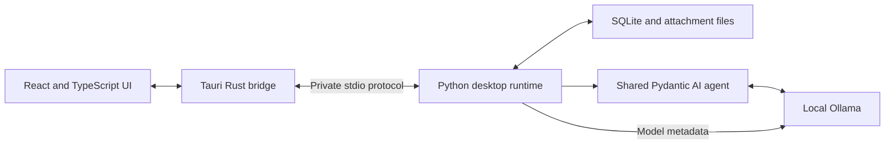

# Vikram local chat

Date: October 14, 2026

Status: approved by the owner on October 14, 2026. Implementation is tracked in
[the build plan](../plans/2026-10-14-local-chat.md).

## 1. Purpose

Vikram is a personal Tauri app for conversations with models installed locally
in Ollama. Pick a model, send text or images, return to earlier conversations,
and organize chats into folders. The interface follows
[raniendu.dev](https://raniendu.dev/).

The first useful outcome is opening the app, selecting a local model, having a
streaming conversation, filing it in a folder, and returning to the same chat
after restarting the app. Desktop inference uses the existing Python/Pydantic
AI agent, sharing its assistant behavior with the CLI.

## 2. Scope and decisions

The owner has confirmed:

- Tauri UI and the existing Python/Pydantic AI agent.
- Multiple chats, one level of folders, and chats outside folders.
- Per-chat model selection; changing models preserves the conversation and
  affects subsequent replies.
- Text and image attachments when the selected model supports images.
- Switching an image chat to a text-only model is allowed with a warning.
  Images stay saved and visible, but that model receives only text.
- Send, stop, copy, and retry failed replies in the first release.
- Per-chat thinking controls limited to values supported by the chosen model.
- Styling based on the owner's website.

The owner approved the following defaults:

| Area | Approved first-release behavior |
| --- | --- |
| Platform | macOS on Apple Silicon; one main application window |
| Persistence | Save chats, images, folder membership, drafts, and settings locally |
| Appearance | Follow macOS by default, with explicit Light and Dark choices |
| Generation | One active reply at a time within the desktop app |
| Chat management | Create, rename, move, delete, and search chat titles |
| Folder management | Create, rename, delete; deleting a folder keeps its chats |
| Images | PNG, JPEG, and WebP; paste, drag and drop, or file picker |
| Inference setup | Use the owner's existing Ollama installation and installed models |
| Instructions | Reuse the shared agent instructions; no per-chat system-prompt editor |

Editing sent messages, regenerating completed replies, conversation branching,
document ingestion, voice, model downloads, cloud providers, synchronization,
and agent tools are outside this release. The existing CLI and evaluation
history remain available. This app does not revive the discarded factory.

## 3. Main interface

Use a native macOS window containing the desktop interface:

- **Sidebar:** New chat, title search, All chats, Unfiled, and collapsible
  folders. Selecting a folder reveals its chats. Most recently updated chats
  appear first. A generating chat has a visible activity indicator.
- **Conversation header:** editable chat title, model picker, supported thinking
  control, and a menu for moving or deleting the chat.
- **Transcript:** user messages, attachment thumbnails, and streamed assistant
  replies. Every assistant reply identifies the actual model used. Markdown,
  lists, and fenced code blocks are supported, with copy controls.
- **Composer:** multiline text, attachment previews with remove controls, and
  Send or Stop. Enter sends; Shift-Enter inserts a newline. Sending is disabled
  during input-method composition and while attachments are being imported.
- **Settings:** appearance and local Ollama connection/status information.

An empty chat explains model selection and offers a place to type. An empty
model list explains how to install a model using Ollama and offers Refresh.
Opening the app or selecting a chat never starts inference automatically.

The chat reading width is approximately `44rem`; the sidebar is collapsible
for smaller windows. Preserve keyboard navigation, visible focus, accessible
control names, selectable text, and reduced-motion preferences.

## 4. Models and thinking

Discover installed models through local Ollama and refresh on app startup,
explicit Refresh, and recovery from a missing-model error. Display readable model
names such as **Gemma 4 · 12B** and **Ornith 1.5 · 35B** consistently in the picker,
empty chat, reply labels, and Settings. Preserve variant/version information and
capitalize technical labels such as MLX and QAT. Settings shows the exact Ollama
ID beneath each name; picker and reply tooltips also expose it. CLI session labels
and help use the same formatting. Formatting is
presentation only: selection values, stored identities, provenance, and model
requests retain the original ID. Show image/thinking capabilities from model
metadata, not name-based guesses. Unsupported chat models and cloud-backed
entries are not selectable.
If local execution cannot be established from the supported runtime's metadata,
show an unavailable state rather than attempting inference.

For a new chat, suggest the last-used installed model, then the repository's
default model if installed. Otherwise require a selection. An existing chat
whose model has disappeared retains its transcript and requests a new choice;
never silently substitute a model.

The thinking control includes Model default plus only the values advertised by
Ollama. Preserve the distinction between booleans and named levels. If metadata
is absent, use Model default without inventing controls. An explicit setting
that is no longer supported must be reset to Model default with a notice.
Remember the setting per chat and model. Keep temperature and other generation
parameters at their shared-agent/model defaults in this release.

Capture model and thinking settings when a request starts. Changing the header
selection affects the next request, not a reply already running. During a
model's thinking phase, keep Stop available. Per the October 15 owner update,
display actual thinking returned by Ollama behind a collapsed **Thinking** row
above the answer. It can expand while streaming, has a bounded scrollable area,
and a separate copy action. Save up to 64,000 characters per attempt with a
truncation notice. Failed and stopped attempts retain their trace. Existing
replies have no recoverable trace. Keep it separate from answer text and exclude
it from future-turn context, logs, and evaluation artifacts. The per-model
thinking setting still controls generation; expanding the trace only changes
its presentation.

Show **Waiting for Ollama** until the runtime actually emits a thinking or text
part. A model's advertised thinking capability alone does not mean it is
thinking; Ollama may be loading it or serving another client. CLI and desktop
share safe failure messages distinguishing timeouts, unavailable models, busy
servers, connection failures and internal app errors. Never include raw provider
error bodies, prompts, or thinking traces in those messages.

Store the requested model and the model reported by the runtime separately.
If an attempt fails before a runtime model is reported, label its requested
model without presenting that value as verified response provenance.

Ollama documents capability and thinking metadata through
[`/api/show`](https://docs.ollama.com/api-reference/show-model-details). The
existing evaluation code already consumes its thinking values; desktop and
evaluation validation should share a small metadata helper when implemented.

## 5. Messages and images

A message may contain text, images, or both. Import images into the app's own
storage before accepting Send, so later movement or deletion of the original
file cannot break a saved chat. Keep previews removable until sending.

Proposed import limits are four images per message, 10 MiB per image, and
24 megapixels per decoded image. Validate file content as well as its extension.
Reject unsupported, oversized, or corrupt files with a clear explanation while
preserving the rest of the draft. Do not silently resize images. These limits
bound app input; individual models can still have stricter limits.

For an image-capable model, send the relevant stored images as image inputs.
For a text-only model, omit image payloads, retain accompanying text, and insert
a short textual marker that an image was omitted. This is not an image
description. Show a notice in the conversation that the model cannot see the
images. Saved images become eligible for context again when switching back to
an image-capable model.

If a draft contains images when switching to a text-only model, keep that draft
and its previews but disable Send until the owner removes those attachments
or selects an image-capable model. Previously sent images never block the
owner from continuing a conversation using text.

Preserve the full stored transcript. Reconstruct inference history from earlier
user messages and completed assistant replies, applying the selected model's
image policy. Failed, stopped, and interrupted assistant attempts remain
visible but do not enter subsequent model history; label this clearly.

The model's working context is finite and separate from saved history. v1 does
not summarize or delete earlier messages automatically, and does not increase
Ollama's context allocation automatically. Explain that an allocated model
context may cover less than the full transcript; show the allocated size only
when the runtime reports it. Context errors preserve the chat and offer starting
a new chat or choosing another model. Ollama's
[context guidance](https://docs.ollama.com/context-length) distinguishes runtime
allocation from model capacity; the UI must not label the maximum supported
capacity as the currently allocated context.

## 6. Sending, stopping, and retrying

Persist a user message once, together with an identified response attempt,
before inference begins. Stream only into the assistant reply belonging to that
chat and attempt. Switching views does not cancel a reply or send its chunks
to another conversation.

One reply may run at a time within this app. The owner can browse other chats
and compose drafts while it runs. Their Send control explains which chat is
busy; v1 has no background send queue. This limit does not control other apps
or CLI processes that use Ollama.

Stop cancels the active request and leaves any received text marked Stopped.
Do not append late chunks after cancellation. Keep the app's generation slot
occupied until the request has terminated or its transport has been closed;
do not start a competing request merely because the UI switched to Stopped.

Retry is available for failed, stopped, and interrupted attempts. It reuses the
original user message and attachments, with the currently selected model and
thinking setting, and creates another attempt. Retain the previous partial
attempt in a collapsed, copyable view. Do not duplicate the user message or
retry automatically. Completed replies have no regenerate action in v1.
Offer Retry only for the latest user turn while it has no completed reply.
After a later user message is sent, older failed attempts remain readable and
copyable without a Retry action. This keeps the conversation linear.

Persist streamed text incrementally. After a crash, mark unfinished attempts
Interrupted and show the last saved partial text. Restarting the app never
resubmits a prompt. Quitting during generation warns that the reply will stop.

## 7. Sessions, folders, and local data

Use one independent history and draft per chat. New chat creates an empty
conversation; it never inherits another chat's messages. Generate the initial
title from the first message's text, or use Image chat for an image-only first
message. This requires no extra model request. The owner may rename it.

A chat belongs to zero or one folder. Folders only organize chats; they do not
share prompts, history, or attachments between chats. Folder names are nonempty
and unique without regard to case. Chats may have duplicate titles.

Deleting a folder moves its chats to Unfiled. Deleting a chat requires a dialog
stating that its messages and app-owned attachments will be removed; original
source files are never deleted. A generating chat must be stopped first.
Each sidebar conversation exposes a visible trash button, including chats inside
folders and search results. The confirmation captures that conversation's ID and
title; changing the selected chat cannot change the deletion target. Deleting
another conversation keeps the current selection. The header menu retains Delete
chat as an alternate route.
Search matches chat titles, including chats inside folders. Full message search
and import/export are deferred.

The shared agent supplies a fresh system timestamp on each model request: local
date/time, weekday, timezone abbreviation, UTC offset, and UTC date/time. The clock
comes from the host and is refreshed even when reusing an agent or continuing a
chat across midnight. It works without web search and uses the same
instructions in the CLI and desktop app. Conversation timestamps are historical;
the current request's supplied clock defines now and today unless the user asks
for another timezone.

Store data outside the checkout, proposed at
`~/Library/Application Support/dev.raniendu.vikram/`. Use SQLite for structured
records and a private attachments directory for image bytes. The logical records
are folders, chats, user messages, response attempts, attachments, and app
preferences. Give chats, messages, attachments, and attempts stable identifiers.

Database changes are transactional and schema-versioned. Checkpoint streamed
text without blocking rendering. Attachment operations must recover from a
crash between file and database writes. App files use permissions limited to the
current account; no additional app password or encryption layer is proposed.
Chat storage is separate from `.vikram/evals/`, whose metrics-only policy stays
unchanged. Prompts, replies, images, and thinking output must not enter logs or
evaluation history.

## 8. Architecture

The proposed frontend is React and TypeScript built with Vite, packaged by
Tauri 2. The Rust bridge owns desktop integration, user-authorized image import,
and Python process lifecycle. The Python sidecar owns chat records, request
state, capability validation, and calls to `build_agent` in `vikram/agent.py`.

Use a versioned, typed stdio protocol with request, chat, and attempt IDs for
commands, streaming deltas, completion, cancellation, and errors. The renderer
does not receive arbitrary shell, filesystem, or SQL access. Image import passes
only owner-selected content into the app's attachment store; later operations
refer to attachment IDs rather than arbitrary filesystem paths.

Launch one bundled Python sidecar per app instance. Check protocol compatibility
at startup and shut it down with the app. Run no app HTTP server and require no
separate Python installation in the packaged release. Development may use the
repository environment. Tauri documents bundling Python executables through its
[sidecar mechanism](https://v2.tauri.app/develop/sidecar/).

Preserve the shared agent's explicit local Ollama endpoint and instructions.
Use its streaming interface and image input support; adapt stored chat records
into model messages for each request. Metadata discovery uses local Ollama's
native endpoints. Do not build a second assistant definition for the UI.

Keep changes to the original CLI and evaluator small. Any shared-helper move
must preserve their command behavior, evaluation identity rules, and saved
history. The pinned Pydantic AI installation has `run_stream` and `BinaryContent`;
its [Ollama integration](https://pydantic.dev/docs/ai/models/ollama/) supplies the
existing model/provider boundary.

## 9. Theme and local operation

Use the actual website tokens, inspected in both themes on October 14, 2026:

| Token | Light | Dark |
| --- | --- | --- |
| Background | `#fbfaf8` | `#14130f` |
| Secondary surface | `#f4f2ec` | `#1c1a16` |
| Foreground | `#14130f` | `#f4f2ec` |
| Muted | `#5c5952` | `#a8a49a` |
| Secondary muted | `#6f6b62` | `#928e84` |
| Border | `#e3e0d8` | `#2b2924` |
| Accent | `oklch(0.52 0.13 47)` | `oklch(0.72 0.12 55)` |
| Focus | `#14130f` | `#f4f2ec` |

Use Space Grotesk for headings, Inter for body text and controls, and system
monospace for code and compact metadata. Bundle the fonts with the app and
retain their licenses. Use the site's `3px` corner radius, fine dividers, and
restrained accent. Scale its typography for a desktop conversation rather than
copying the homepage's oversized heading.

System appearance is the proposed default; manual Light and Dark choices persist
between launches. Keep sufficient contrast, visible keyboard focus, and a clear
distinction between selected, unavailable, and generating states.

Local chat works with the internet disconnected once Ollama and local models
are installed. Web tools report unavailable network access when invoked offline.
App assets and fonts load locally. Chat content is not
sent to analytics or hosted inference. A local Ollama address alone is not proof
of local inference: [Ollama can also route cloud models](https://docs.ollama.com/cloud),
so model admission must reject cloud-backed entries.

Render model output as untrusted Markdown. Disable raw HTML, scripts, and remote
image loading. Open ordinary external links only on an explicit user click in
the system browser. Never execute generated code. The model receives attached
content and has no tools to browse the filesystem. Models with tool support
always have automatic web search under the
[document and search extension](2026-10-14-documents-and-web-search-design.md),
which describes the queries sent to Parallel and the bounded tool policy.

## 10. Failure behavior

| Condition | Required behavior |
| --- | --- |
| Ollama unavailable | Preserve the draft and history; explain how to start Ollama and offer reconnect |
| No installed chat models | Show the empty-model state and Refresh |
| Selected model removed | Preserve its name and earlier replies; require a new selection |
| Missing capability metadata | Explain unavailable capabilities; never guess image or thinking support |
| Unsupported thinking override | Notice and reset to Model default before the next request |
| Attachment import fails | Keep the draft and successfully imported attachments; explain the failed file |
| Model load, context, or generation failure | Mark the attempt failed, retain saved partial output, offer Retry |
| Sidecar exits | Preserve the UI draft, mark an active attempt interrupted, offer reconnect |
| Disk full or persistence failure | Stop generation, retain unsaved text in the current UI, visibly mark it unsaved, and offer copy |
| App restarts | Restore saved state; mark unfinished attempts interrupted; do not auto-run anything |

Errors should be understandable without stack traces, prompts, or filesystem
internals appearing in routine UI or diagnostic logs.

## 11. Acceptance criteria

1. Launch the packaged Mac app with existing Ollama and local models; select a
   model and receive a streamed reply through the shared Python agent.
2. Create two chats with different model choices. Switching between chats keeps
   their drafts, messages, model choices, and settings separate.
3. Change model within a chat. Earlier messages remain unchanged, new replies
   use the new selection, and every reply retains its actual model attribution.
4. Attach an image to a vision model. After sending, move the original file and
   restart the app: the chat's preview and saved image input still work.
5. Switch that conversation to a text-only model. A warning is visible; outbound
   requests contain text and omission markers, but no image bytes. Switch back
   to a vision model and verify saved images can be supplied again.
6. Show only advertised thinking values. Persist a chosen setting, handle model
   changes, and reject stale or unsupported overrides without guessing.
7. Stop a reply, switch chats, and inject late stream chunks in a test. They
   neither alter the stopped reply nor appear in another chat.
8. Retry a failed or interrupted attempt without duplicating the user message.
   Restart after a partial stream and recover the last saved text as Interrupted.
9. Create, rename, and delete folders; move chats into and out of them. Deleting
   a folder preserves chats. Deleting a chat leaves original source images alone.
10. Verify both website palettes, system appearance changes, keyboard navigation,
    multiline input, image paste/drop, and Markdown/code copy behavior on macOS.
11. With the internet disconnected, local model discovery and chat still work.
    Reject cloud-backed model entries and avoid external font or image requests.
12. Verify missing Ollama, removed models, invalid images, sidecar crashes, and
    persistence failures produce the defined recoverable states.
13. Confirm the original CLI and evaluation commands still start, existing
    history remains readable, and no chat content enters evaluation artifacts.

Use focused offline tests for persistence, metadata validation, history mapping,
IPC routing, cancellation, and recovery, with mocked inference. Perform explicit
manual local-model checks for text, images, and thinking, plus a packaged-app
smoke check. Do not run live model evaluations or hosted inference automatically.

## 12. Review focus

Confirm the proposed defaults in section 2, especially macOS-only delivery,
local history retention, system/light/dark appearance, and one active reply
within the app. The owner's confirmed choices are retained in the
[discovery record](2026-10-14-local-chat-discovery.md).
