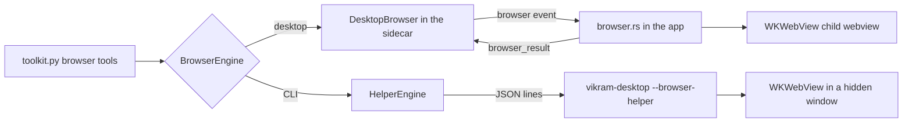

# An agent-controlled browser

Date: October 21, 2026

Status: requested by the owner on October 21, 2026 ("give the Vikram desktop app
its own embedded browser that the agent can control ... while the person watches
it live in a panel and can stop it or take over"), then implemented on top of the
[questions, plan mode, and sandbox design](2026-10-20-questions-plan-mode-sandbox-design.md)
with the three decisions below.

## 1. Outcome

Tool-capable local models get six browser tools in both interfaces:
`browser_open`, `browser_click`, `browser_type`, `browser_scroll`, `browser_back`,
and `browser_look`. In the desktop app the browser is a WebKit panel beside the
chat that the person watches live, can take over, stop, or close. In the CLI the
same engine runs hidden. Consequential actions wait for the person's approval;
password, payment, and one-time-code fields are refused; the browser has a
private, non-persistent profile and cannot reach local or private networks.

## 2. Owner decisions

Asked before building, each with a recommendation:

| Question | Options offered | Owner's choice |
| --- | --- | --- |
| Engine | Tauri child webview (WKWebView); Playwright Chromium in the sidecar (Harness `PlaywrightBrowser`); Chromium inside the microVM | **Tauri child webview** (recommended) |
| Safety | Ask before consequential actions; ask before every action; read-only agent | **Ask before consequential** (recommended) |
| CLI | Unavailable with a notice; headless variant | **Headless variant** |

Why the child webview: the panel is the real page, so watching and taking over
need no streaming or input forwarding; nothing is downloaded and the app does
not grow; web content runs in WebKit's own sandboxed processes. Its cost is that
clicks and typing are script events, which a few sites ignore (section 9).

The live check was specified with `gemma4:26b-a4b-it-qat`, which was no longer
installed in Ollama; the owner chose to run it through Magnitude (section 10).

## 3. Architecture

- `vikram/browser.py` defines the engine contract (`act(call) -> result`,
  `paused`, `resumed()`), validates every engine result with Pydantic, formats
  page views for the model, repairs small-model arguments, and runs the CLI's
  helper process.
- `vikram/toolkit.py` owns everything model-facing: which tools are offered,
  limits, plan-mode rules, approvals, take-over waits, activity records, and
  per-request trimming of page views. CLI and desktop send identical requests
  (a parity test drives a browser turn through both).
- `apps/desktop/src-tauri/src/browser.rs` is the one engine implementation. The
  app creates it as a child webview of the main window; the same binary, run as
  `vikram-desktop --browser-helper`, creates it in a hidden window and answers
  JSON lines on stdio. `browser.js` is the page script.

The browser outlives replies: in the app until the person closes it or quits,
in the CLI until the session ends. It is shared by all chats in the app.

## 4. Model-facing behavior

- **Tools.** Registered with the toolkit and offered only to replies that have an
  engine, so the same agent serves interfaces and evaluations with or without a
  browser, and the existing prompts and evaluation fingerprints are unchanged.
  Like the rest of the toolkit, the browser needs a tool-capable model.
- **Page views.** Each action returns a lead line ("Clicked link “Docs”."), the
  title and URL, notes (a blocked pop-up or download, a page that did not open),
  up to 60 numbered elements ("[3] text field “Search” = “kettle”",
  "[4] checkbox “Gift wrap” (checked)"), up to 4,000 characters of visible text
  from the top of the view down, labeled untrusted, and the scroll position.
  Vision models also get a JPEG of the viewport, about 1,024 pixels wide.
  Numbers are reassigned at every view.
- **Bounded context.** Only the latest page view is sent in full; older ones
  keep their first lines (what was done, and where) via a `before_model_request`
  hook that changes requests, not saved history. Screenshots are never stored.
- **Argument repair.** Small models send `"element": "[12]"`, `ref`, `value`,
  `press_enter: "true"`, or a URL without a scheme; a `before_tool_validate`
  hook repairs these, and strict validation still runs.
- **Limits.** Eight browser actions per reply (within the ten-request limit).
- **Plan mode.** Opening, reading, scrolling, and going back are allowed for
  research; clicking and typing are refused (a finished result, as for
  `run_code`) until the plan is approved.
- **Follow-up context.** Completed replies add the last six browser actions and
  where the browser was left (title labeled untrusted, and URL).

## 5. Safety

- **Profile.** A non-persistent WebKit data store: none of the owner's Safari
  or other browsers' cookies or passwords, and nothing kept after the browser
  closes or Vikram quits.
- **Untrusted content.** Page text and titles are labeled untrusted for the
  model; the instructions say never to follow them.
- **Approvals.** The page script classifies an action before running it:
  - any form submission (a submit button, or `submit` on `browser_type`, which
    presses Enter; Enter always asks because it may send what was typed);
  - a sign-in (a form with a password field);
  - a click whose accessible name says buy, order, pay, checkout, subscribe,
    book, donate, delete, remove, transfer, unsubscribe, sign in, register, post,
    send, reply, share, upload, confirm, accept, agree, allow, or similar (for
    plain links, only the buy and delete groups).

  The action waits for the person (a card in the app, `y`/`n` in the terminal)
  for up to 15 minutes. Only an interface that implements `Approver` can allow
  one; piped runs, evaluations, and tests decline. A declined action is not
  asked again in the same reply. Typing before Enter is visible in the panel
  before the person decides.
- **Refusals.** Password, payment-card, and one-time-code fields (by type,
  `autocomplete`, name, label, or placeholder) are never typed into, and their
  values never reach the model; file uploads are refused.
- **Network.** Only public `http`/`https` pages open (`browser_open` checks in
  Python; the navigation policy checks again in Rust). A WebKit content blocker
  blocks every request a page makes to localhost, `.local`, `.internal`,
  `.lan`, `.home`, `.home.arpa`, `.test`, single-label hosts, private,
  link-local, and carrier-grade NAT (Tailscale) ranges, and IPv6 literals. If
  the blocker cannot be installed, the browser does not start. A public name
  that resolves to a private address is not caught (section 9).
- **No downloads, uploads, or windows.** Downloads are cancelled, pop-ups and
  new windows are denied (new-tab links open in place), and JavaScript dialogs
  are dismissed by WebKit's defaults.
- **App isolation.** Tauri refuses app commands from remote origins unless a
  remote capability allows them; none does. The app's capability now names the
  chat webview (`webviews: ["main"]`) rather than the window, so the panel is
  outside it even for local origins. The page script runs in its own WebKit
  script world (`WKContentWorld`), so pages cannot replace or observe it.
- **Privacy.** No browsing content is logged. Activity records keep actions,
  targets, typed text (bounded), and URLs; never page text or screenshots.

## 6. Take over, stop, and close (desktop)

- **Take over** pauses Vikram: the next browser action waits ("paused") until
  the person chooses **Hand back**, then continues with a note that the page
  may have changed. The person's own input reaches the page at any time.
- **Stop** stops the reply, as everywhere else; an in-flight action finishes in
  WebKit and its late result is dropped.
- **Close** destroys the webview (ending its private session); a waiting action
  fails with "The user closed the browser", and the browser is not reopened in
  that reply. A later reply opens a new one.

## 7. Interfaces

**Desktop protocol** (no schema change; the browser is not persisted):

| Direction | Message | Purpose |
| --- | --- | --- |
| sidecar → app | event `browser` (`call_id`, `call`) | run one action; never shown to the window |
| app → sidecar | `browser_result` (`call_id`, `result`) | the engine's answer, validated by the toolkit |
| app → sidecar | `browser_closed` | the person closed the panel |
| window → sidecar | `browser_control` (`person` or `agent`) | take over or hand back |
| window → sidecar | `respond` with `kind: "browser"` | allow (`approve`) or decline (`dismiss`) |
| sidecar → window | event `browser_control` | the current controller |

`browser_result` and `browser_closed` come from the app itself and are not in
the window's command allowlist. The window reports the panel's bounds,
visibility (the panel hides under the app's dialogs), and close to Rust through
native commands, and receives page title, URL, and loading state as `browser`
events.

**Desktop UI:** the panel shows the page, its title and address, a status line,
and **Take over** / **Hand back**, **Stop**, and close. The reply shows a
collapsible "Browser · N actions" log, an approval card for a waiting action,
and a hand-back card while Vikram waits for the browser.

**CLI:** the hidden helper starts on first use (it must print a ready line
within 20 seconds, so an older app binary is stopped rather than opening its
window), approvals are `y`/`n` prompts, `/activity` lists browser actions, and
the plain one-shot mode prints one line per action.

## 8. Engine details

- Every action runs `browser.js` with `callAsyncJavaScript` in one long-lived
  named script world; WebKit discards a world that nothing holds, so the app
  keeps it for the life of the process, and the script keeps strong references
  to numbered elements (the world's DOM wrappers are otherwise collected).
- Clicks dispatch pointer and mouse events, then `click()`. Typing uses the
  prototype's value setter and `input`/`change` events, so frameworks such as
  React register it; selects choose by label; Enter dispatches key events and
  submits the form.
- After an action that may navigate, the engine waits for a load to start and
  finish (`isLoading`, up to 20 seconds) and lets scripts render before reading
  the page. WebKit keeps the previous page when a load fails, so an `open` that
  ends where it started reports that the page did not open.
- Snapshots use `WKSnapshotConfiguration` and are encoded as JPEG (quality 0.6).
- The panel is placed from the window's report of its area. The window's
  content view runs under the title bar and WebKit insets the chat page below
  it, so the engine adds that inset (from `contentLayoutRect`).
- `background_throttling` is disabled so the hidden helper keeps rendering, and
  creating the panel brings the app forward, as wry does for new webviews.

## 9. Limitations and follow-ups

- Script events are untrusted (`isTrusted` is false); a few sites ignore them.
  The person can take over. Native trusted clicks could be added later.
- Only the main frame is read and used; frames are noted but not entered. Open
  shadow roots are read; closed ones are not.
- The content blocker matches addresses, not resolved IPs, so DNS rebinding to
  a private address is not blocked.
- The headless CLI browser cannot be watched or taken over, so it cannot sign
  in; Vikram explains what the person would need to do.
- Every form submission asks, including searches; a model can often open a
  search URL directly instead.
- Follow-up: per-chat browser sessions, an address bar for the person, and
  native input for sites that require trusted events.

## 10. Evaluation and verification

**Evaluation.** A `browser-lookup` case asks for a price on an offline site
(`vikram/evals/site.py`): canned pages answered through the same engine
protocol, with the price one click away on an address that cannot be guessed.
It passes only when the answer is exactly `$48` and a browser action completed.
The site's source and its completion check join the protocol fingerprint, and
the browser guidance joins the agent fingerprint, only when the case is
selected; a test pins the original tool cases' suite, protocol, and agent
hashes. The default suite gains the case (twelve cases).

**Offline tests.** Python: toolkit behavior with a fake engine (offers,
approvals, declines, refusals, plan mode, private addresses, limits, take-over,
trimming, repairs), the helper process (handshake, crash, timeout), the desktop
runtime's round trip, protocol validation, CLI parity, terminal prompts, and
the evaluation case. Frontend: the page script in jsdom (numbering, hidden
values, approval rules, refusals, filling, Enter), the panel, cards, and
`useChats`. Rust: navigation policy, content-blocker rules, action validation,
and JSON-literal embedding of typed text.

**Live checks (October 21, 2026).**

- The helper (release and debug builds) on example.com, iana.org, httpbin.org
  forms, and a test login page: numbering, typing, radios, the approval gate on
  "Submit order" (the POST then arrived), the password refusal, sign-in
  approvals, back, blocked private addresses, and a 1,024-pixel snapshot.
- CLI with `gemma4:12b` (Ollama) and with Gemma 4 26B-A4B (Q4 QAT) served by
  Magnitude: open, click, and report; a piped run declined "Submit order" and
  the model explained it needed approval; an interactive run allowed two
  approvals and reported httpbin's echoed name.
- The built app's release binary with a test sidecar: a scripted stand-in model
  showed the panel, the approval card, the submitted form, take over, and hand
  back; then Gemma 4 26B-A4B through Magnitude filled httpbin's form (name,
  size, topping), waited for approval, submitted, and reported the echoed
  values.

Vikram's model endpoint is fixed to Ollama, so the Magnitude runs used a
test-only shim outside the repository (a `sitecustomize` on `PYTHONPATH`, and a
copy of the built app whose sidecar was the checkout's Python) to point the same
requests at Magnitude's local OpenAI-compatible endpoint. No product code
changed for it. The app's screen was locked during part of the check, so the
final panel placement was confirmed from AppKit frames rather than a screenshot.
