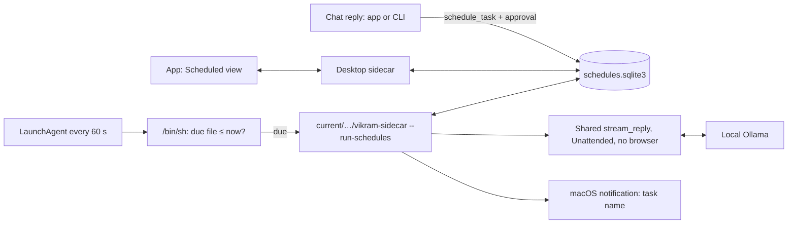

# Scheduled tasks

Date: October 27, 2026

Status: requested by the owner ("prompts that run on a schedule, including while
the desktop app is closed, and that the model itself can create when I ask it"),
then implemented with the four decisions below on top of Vikram 0.2.0.

## 1. Outcome

A scheduled task is a name, a schedule in the Mac's local time, a prompt, and a
model. Vikram runs it at its times as a fresh, unattended conversation, even when
the app is closed, and keeps each run's answer, thinking, sources, and tool
activity.

- **From chat.** Tool-capable models get `schedule_task`, `list_scheduled_tasks`,
  `update_scheduled_task` (which also pauses and resumes), and
  `delete_scheduled_task`, in the app and the CLI. Saving a new or changed task
  waits for the person's approval.
- **In the app.** **Scheduled** in the sidebar lists tasks with schedule, next
  run, and last result; the person can create, edit, pause, resume, run now,
  and delete them, open a task's run history, read a run as a chat turn, and
  continue a finished run in a new chat.
- **In the terminal.** `vikram schedules` lists tasks and whether background
  runs are on; `--run-due` runs due tasks in the foreground (for checkouts).

## 2. Owner decisions

Asked before building, each with a recommendation:

| Question | Options offered | Owner's choice |
| --- | --- | --- |
| What may an unattended run do? | Web + sandbox, no browser; also a read-only hidden browser; text only | **Web + sandbox, no browser** (recommended) |
| Approval for model-created or edited tasks | Approve create/edit, not pause/resume/delete; no approval | **Approve create/edit** (recommended) |
| Notification when a run finishes | Task name only; name and start of the answer; none | **Task name only** (recommended) |
| A time missed while the Mac slept or was off | Catch up once if under 12 hours late; always catch up once; skip | **Catch up once if under 12 hours late** (recommended) |

Why approval: page content and documents are untrusted, and a task persists and
runs later by itself. Requiring the person's OK before anything is saved means
injected text can at most propose a task, never plant one. Pausing and deleting
only reduce what runs, so they need no approval.

## 3. Architecture

**Storage.** Tasks and runs live in `schedules.sqlite3` beside the chat library
(`~/Library/Application Support/dev.raniendu.vikram/`), not in `chats.sqlite3`.
The open app or CLI holds the chat library's `runtime.lock`, so a background run
could not write a chat while the app is open; a separate WAL database lets the
runner, the app, and the CLI use tasks at once with short transactions. The app
learns of outside changes by polling SQLite's `data_version` every two seconds
and reloads what is open. Each task keeps its latest 50 runs. **Continue in a
chat** copies a run into the chat library from the app's own process.

**Background service: one LaunchAgent.** Considered:

| Design | Why not chosen, or chosen |
| --- | --- |
| A LaunchAgent per task with `StartCalendarInterval` | Rewrites and reloads agents on every edit, cannot express intervals or "once", and leaves more agents to go stale. |
| An always-on scheduler daemon | A resident Python process (and memory) for something that runs a few times a day. |
| **One agent, `StartInterval` 60 s, shell guard** | **Chosen.** The plist never changes with tasks. launchd starts `/bin/sh`, which reads an epoch-seconds "next due" file and exits unless a task is due, so the onefile Python runtime (which unpacks on start) only starts when there is work. After sleep, launchd fires the overdue interval once on wake. |

The store rewrites the due file (`scheduler-next-due`) after every change: the
soonest enabled run, `0` for "run now", or no file when nothing is scheduled.
The agent's command is fixed text with its paths passed as arguments
(`$1`–`$5`), so no path is ever interpolated into shell code, and its output goes
to `/dev/null`.

**Lifecycle.** The agent exists only while an enabled task exists. The app (when
it opens the task list and after each change), the CLI (after a model change),
and the runner (after its last run) install or remove it to match. It starts the
runtime through the install's `current` link, so an update needs no change;
`install_bundle` also rewrites an existing agent's definition for the new
version, and the app does so on start if it differs. If the install folder is
gone, the agent deletes its own plist and boots itself out, so removing Vikram
leaves nothing running. Only the installed, frozen runtime installs the agent;
a checkout, an overridden test library (`VIKRAM_CHAT_DATA_DIR`), or a disposable
install home never touch launchd.

**Runs.** The runner takes a non-blocking `scheduler.lock` (one runner at a
time; a second exits and the first picks up its work), marks runs a killed
runner left `running` as interrupted, then claims due tasks one at a time. A
claim advances the task to its next time after *now*, so several missed times
collapse into one run; a run more than 12 hours late is recorded as missed
instead. **Run now** sets a flag and starts a detached runner (`start_new_session`)
that outlives the app. SIGTERM from launchd stops a run as `stopped`.

Each run calls the shared `stream_reply` exactly as a chat does, with an empty
history, the task's prompt, `Unattended()` (questions declined, approvals
refused), no browser engine, and no task tools. Its instructions name the task
and say nobody is present: decide, say what was chosen, and reply with the
result itself. The answer, thinking, activity, sources, and searches are
checkpointed at most once a second so an open app shows progress.

## 4. Model tools

Small local models send flat arguments more reliably than nested objects, so
`schedule_task` takes `name`, `prompt`, `repeat` (`once`, `daily`, `weekly`,
`monthly`, `interval`) and only the fields that kind uses: `date`
(`YYYY-MM-DD`), `time` (24-hour `HH:MM`), `days` (`mon`…`sun`), `day_of_month`,
`every_minutes` (at least 15). The docstring gives three worked examples, and the
instructions tell the model to work dates out from the supplied clock.

`repair_task_arguments` runs before validation and fixes what Gemma-class models
commonly send: `8am`/`3 pm`/`20.30`, `weekdays`/`weekends`/day names in prose,
a full ISO datetime in `time` (split into date and time, converted to local
time), `tomorrow`, `hourly`/`every_hours`, a nested `schedule` object, ordinal
days (`1st`), `task_id`/`id` for `task`, string booleans for `paused`, and extra
keys such as `timezone`, which are dropped instead of spending a retry. Strict
validation then runs; a bad or past schedule is a finished tool result that
says what is wrong and how to fix it, never a retry loop. Tasks are found by id,
eight-character id prefix (as `list_scheduled_tasks` shows), or name.

The tools are offered for a whole reply or not at all (replies with a task book:
app and CLI chats; not scheduled runs or evaluations), so availability never
changes mid-reply. In plan mode, changes are refused with a finished result that
points to `submit_plan`; listing still works. Six task tool calls per reply.
Follow-up turns see which tasks were scheduled, changed, or declined.

Approval reuses the browser's approval contract: `ActionRequest` gained
`kind="schedule"`, the app shows a card (name, schedule, prompt; **Save task** /
**Don't save**) and the terminal a `y`/`n` panel. Without an approver (piped
runs, evaluations, scheduled runs) nothing is saved.

## 5. Privacy and safety

- Runs never log prompts or answers; the agent's output is discarded, and
  notifications carry only the task's name (macOS keeps notification text in its
  own history, which is why the answer is left out).
- Runs have no browser and cannot create tasks, so a run cannot extend itself.
- The database and due file are created with the library's private permissions
  (`0600` files in a `0700` folder); the agent plist is the only file outside it.
- Isolated test libraries never notify, and no test touches the account's
  launchd.

## 6. Limits

- Ollama must be running at the time of the run; otherwise the run fails with
  Ollama's usual message (shown in the app; the notification says it did not
  finish). Vikram does not start Ollama.
- Minute resolution: a run starts within about a minute of its time.
- A Mac that is shut down runs nothing; on the next login a run less than 12
  hours late catches up once.
- Schedules follow the Mac's current time zone, so 08:00 stays 08:00 after
  travel or a daylight-saving change.
- Background runs need the installed app. In a checkout, use
  `uv run vikram schedules --run-due`.
- Notifications are posted with `osascript`, which macOS attributes to Script
  Editor; they appear only if Script Editor may send notifications (System
  Settings › Notifications). A notification from Vikram's own identity would
  need a signed helper app, which is out of scope here.

## 7. Validation

Offline tests (`tests/test_schedules.py`) cover next-run math across daylight
saving time and month ends, argument repair, the store (due file, pause, run
now, catch-up and missed runs, history limit, cross-process changes), the runner
with fakes (unattended, no browser, safe failures, stop), the agent lifecycle
with a fake `launchctl`, the agent's shell command (only starts the runtime when
due, removes itself when Vikram is gone), the model tools through the real reply
loop (approval, decline, no approver, list/pause/delete, merge edits, plan
mode), and the desktop commands, approval card round trip, and "continue in a
chat". Frontend tests cover the Scheduled view, the task editor, the approval
card, and refreshing on background changes. `scripts/check_installer.py` runs
the agent's own command, in launchd's minimal environment, against a disposable
install and library and checks that the frozen runner records the run.

The live check is in section 8.

## 8. Live check

On October 27, 2026, with local Ollama and `gemma4:12b` (the default
`gemma4:26b-a4b-it-qat` is not installed in Ollama on this Mac), thinking off:

- **Chat tools** (shared `ChatSession`, an approver that says yes, a disposable
  library). "Every weekday at 8am, summarize the top technology news for me."
  → approval for “Daily Tech News Summary” · Weekdays at 08:00, saved. "Remind
  me tomorrow at 3pm to call the dentist." → “Call the Dentist” · Once on Wed
  28 Oct 2026 at 15:00, saved. "What scheduled tasks do I have? Then pause the
  tech news one." → listed both and paused the first, without approval.
- **Background run with the app closed.** The PR's build was installed into a
  disposable home; a one-time task was due at 06:38 in a disposable library.
  The agent's own command was run every 60 seconds with launchd's minimal
  environment (loading a LaunchAgent is a persistent change that this session's
  permission check refuses, so the timer was simulated; the owner can run the
  real one). Before the due time the shell exited in under 0.1 s without
  starting Python; at 06:38 it started the installed runtime through
  `current`, which answered "Time to stand up and stretch!" in 6.8 s, marked
  the task done, and removed the due file. The installed desktop service then
  listed the run, showed it in the task's history, and continued it in a chat.
- `scripts/check_installer.py` passed with the new scheduler check.
